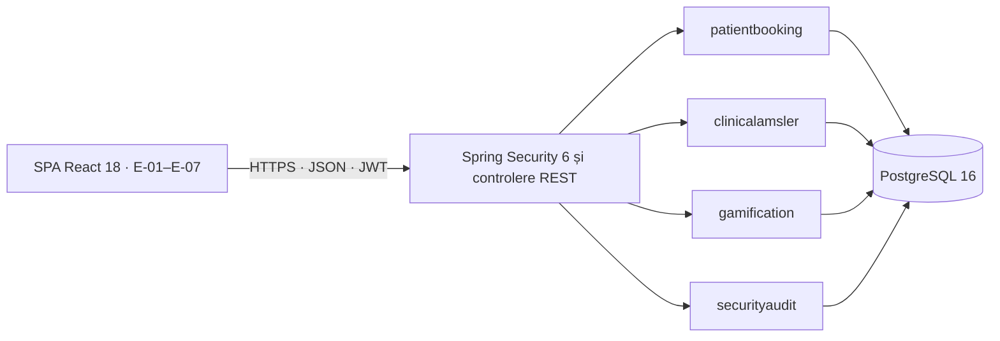

# OphthaCloud — Arhitectură software și plan de execuție

**Platformă Clinică Oftalmologică cu Modul de Implicare a Pacientului**  
Universitatea din București · Facultatea de Matematică și Informatică · Ingineria programării · Echipa 19

| Document de decizie | Detalii |
|---|---|
| Autor și responsabil de integrare | Adrian Diaconescu, Software Architect & Lead Backend Engineer |
| Destinatari pentru avizare | Echipa Master 20 (MEDS), Ignat Eduardo și Pantaziu Andrei-Rareș |
| Coordonator al disciplinei | Prof. dr. Radu Gramatovici |
| Stare la 24 noiembrie 2026 | Plan revizuit conform feedback-ului Echipei Master 20. Următoarea demonstrație în fața profesorului este EPIC Review din 16 decembrie 2026. |
| Decizie solicitată | Confirmarea alinierii pe executarea în paralel (cu mock data frontend și integrare treptată FE–BE), Docker limitat la PostgreSQL în decembrie și focus pe teste unitare. |

## 1. Rezumat executiv și guvernanța arhitecturală

Pe **16 decembrie**, recepționerul va înregistra un pacient și îl va programa, medicul va documenta consultația și va prescrie picăturile, iar pacientul va confirma o doză de pe primul ecran după autentificare. Medicul va vedea efectul confirmării în istoricul și procentul de aderență. Același pacient, aceeași programare și aceeași prescripție trebuie să traverseze demonstrația în aplicația locală.

**Cele trei priorități stabilite pentru evaluare**, în ordinea în care ghidează deciziile de implementare, sunt următoarele.

1. **Experiența pacientului are prioritate.** Bara de accesibilitate funcționează chiar la autentificare. Pacientul poate mări textul la 200%, poate activa contrastul ridicat și ajunge la confirmare în cel mult două acțiuni, inclusiv trimiterea formularului de login. Echipa verifică acest traseu pe telefon, din tastatură și cu cititor de ecran.
2. **Fiecare increment închide un scenariu clinic.** Recepția produce o programare reală pentru medic. Prescripția medicului produce dozele afișate pacientului. Confirmarea pacientului produce un rezultat observabil în cabinet.
3. **Gamificarea se introduce gradual.** În decembrie, pacientul vede progresul zilei și seria de bază. În ianuarie apar scuturile de continuitate, apoi voucherele și controlul clinicii asupra emiterii lor. Mesajele încurajează reluarea tratamentului, inclusiv după o zi omisă.

**Arhitectura se stabilește acum pentru întregul semestru.** Adrian menține dicționarul de date, contractele REST și exemplele comune pentru cele patru roluri. După aviz, o modificare incompatibilă primește o decizie scurtă cu motiv, impact asupra clienților și datelor, migrare și teste. La fiecare întâlnire cu profesorul, fiecare membru demonstrează partea pe care a implementat-o. Adrian consemnează observația profesorului, scenariul afectat, responsabilul, criteriul de acceptare și data reverificării. Echipa 19 și mentorii folosesc minuta pentru a recalibra următoarea fereastră. Calendarul din ianuarie reprezintă propunerea care va fi reexaminată după 16 decembrie.

### 1.1. Alinierea cu Raportul de Proiectare (Echipa 19) și Raportul de Planificare Inițială (Echipa Master 20)

| Decizie armonizată | Aplicare concretă în planul academic |
|---|---|
| **Izolarea modulului și a schemei academice (`SP-01`, `SP-02`, `CDV-01`)** | Modulul academic folosește **Java 21** și **Spring Boot 3.3.x** ca monolit modular stratificat (`Controller → Service → Repository`), cu bază **PostgreSQL 16** dedicată în Docker (`docker compose` doar pentru BD până pe 16 dec) și migrări **Flyway (`V1..V7`)** pornind de la o schemă curată. Backendul și frontendul (React 18, TypeScript, Vite, Tailwind, Radix UI) rulează nativ local. |
| **Simplificări agreate (`SP-05`, `CAP-02`, `SA-02`, `SA-11`)** | Calculul dozelor zilnice se face dinamic din `treatment_plans.schedule_hours` (evitând dependența de job-uri cron nocturne greu de testat); orice celulă marcată pe Grila Amsler declanșează alertă către medic cu preluare explicită și marcarea severității foveale; recepția activează contul pacientului la creare (`SA-02`). |
| **Ajustări conform feedback-ului Echipei Master 20 (24 noiembrie)** | (1) În decembrie, **Docker pornește doar PostgreSQL 16**, iar containerizarea completă (`backend + frontend + db`) și rafinarea CI se mută în **Valul 2 (ianuarie–februarie)**; (2) **CI minimal acum** (un YAML simplu `build + unit tests` pe PR/MR); (3) **Lucru în paralel imediat** între toți 3 membrii folosind **mock data pe Frontend** și **legare FE–BE din timp**; (4) **Testare bazată pe teste unitare** (`JUnit 5 + Mockito`, 1–2 scrise manual ca șablon, apoi extinse cu AI) + probe manuale în browser, fără teste de integrare sau E2E obligatorii. |
| **Ajustare fermă pentru EPIC Review (16 decembrie)** | Față de planificarea inițială, **bara completă de accesibilitate (`CIC-06.1`: scalare text 100%–200% și High-Contrast)** și **seria de bază (`SA-13` parțial)** devin obiective ferme în fereastra de decembrie (nu opționale), iar intervalul **8–15 decembrie** este rezervat integral integrării și stabilizării. |

Referințele oficiale ale proiectului sunt [Raportul de proiectare](docs/rapoarte_ingprog/IP2026_Raport_de_proiectare_Echipa_19.md), [Raportul de analiză](docs/rapoarte_ingprog/IP2026_Raport_de_analiza_Echipa_19.md) și *Raport de planificare inițială*, Echipa Master 20, 2026.

## 2. Distribuția rolurilor în Echipa 19 și responsabilitățile tehnice

| Rol de inginerie | Răspundere individuală | Dovadă prezentată profesorului |
|---|---|---|
| **1 · Adrian Diaconescu — Software Architect & Lead Backend Engineer** | Arhitectură, REST, Java 21/Spring Boot 3.3, PostgreSQL 16, Flyway V1–V7, Compose și CI. Spring Security 6, JWT, RBAC și audit AOP. Registru pacienți, activare cont, `CnpModulo11Validator`, căutare, programări, consultații AV/TIO/ICD-10, `treatment_plans`, API clinic Amsler și integrare. | În decembrie urmărește în API și în BD traseul înregistrare → programare → consultație → rețetă și demonstrează respingerea unei suprapuneri. La final arată controlul administrativ și trasabilitatea accesului la fișă. |
| **2 · Dobrescu Andrei-Alexandru — Inginer responsabil de gamificare și implicarea pacientului** | Rezolvarea dozelor din `schedule_hours`, confirmare, procent și istoric pentru medic, serie, scuturi, insigne, praguri și emitere idempotentă. Deține regulile de validare/decontare a voucherelor și clasificarea severității Amsler. | În decembrie explică trecerea de la doza așteptată la procent și serie, inclusiv la dublu clic. În ianuarie demonstrează ziua protejată, un singur voucher la prag și clasificarea unei celule centrale. |
| **3 · Iovan Andrei-Alexandru — Inginer responsabil de SPA și accesibilitatea pacientului** | React 18, TypeScript, Vite, Tailwind, autentificare și rutare, ecranele E-01–E-07, contractele clientului HTTP, SVG Amsler, timer, răspuns vizual și vocal la acțiuni, probe de utilizabilitate. | În decembrie parcurge traseul pacientului la 200%, în contrast ridicat și din tastatură. La final demonstrează selectarea accesibilă a unei celule, portofelul și ecranul administrativ. |

Numele responsabililor pentru gamificare și frontend urmează specializările consemnate de echipă. Adrian răspunde de integrarea finală. De exemplu, la decontare Dobrescu scrie regula și testul de concurență, Adrian asigură actualizarea programării în aceeași tranzacție, iar Iovan prezintă rezultatul la recepție. [Distribuția specializărilor](docs/rapoarte_ingprog/Plan_Extindere_OphthaCloud_IP2026.md)

## 3. Arhitectura software detaliată

### 3.1. Stivă, limitele modulelor și tranzacții

Un browser, un proces API și o bază relațională sunt suficiente pentru fluxul clinic. O tranzacție PostgreSQL poate cuprinde atât confirmarea dozei, cât și efectele asupra profilului pacientului. Acest lucru reduce numărul de moduri în care pacientul ar putea primi o confirmare pe ecran fără ca medicul să vadă rezultatul.



Backendul este un **monolit modular stratificat** în Java 21 LTS, Spring Boot 3.3.x. În fiecare pachet, fluxul este **Controller → Service → Repository**. Controlerul validează forma DTO-ului, serviciul verifică dreptul asupra resursei și deține tranzacția, iar repository-ul Spring Data JPA emite interogări parametrizate. API-ul serializează DTO-uri explicite. Entitățile JPA și repository-urile aparțin exclusiv modulului lor.

| Pachet | Date deținute | Interfață între module |
|---|---|---|
| `patientbooking` | `patients`, `appointments` | Expune identificarea pacientului, relația medic–pacient și agenda. Creează contul prin serviciul de identitate. Oferă operația de atașare a voucherului la o programare blocată. |
| `clinicalamsler` | `consultations`, `treatment_plans`, `amsler_tests` | Verifică programarea prin `patientbooking`. Expune planuri valabile pe un interval, inclusiv versiunile istorice. Salvează testul și severitatea în aceeași tranzacție. |
| `gamification` | `adherence_logs`, `gamification_profiles`, `discount_vouchers` | Citește prescripția prin interfața clinică. Calculează dozele și rezultatele, solicită politica de recompense și orchestrează decontarea prin interfața programărilor. Consola medicului citește sumarul direct din API-ul de aderență. |
| `securityaudit` | `users`, `clinic_settings`, `gdpr_audit_logs` | Furnizează identitatea, verificarea rolurilor, politica clinicii și auditul. Expune operații administrative. Aspectul extrage actorul din contextul autentificat și ținta din acțiunea autorizată. |

Comunicarea între module se face prin servicii publice cu identificatori și DTO-uri. O verificare de arhitectură în CI interzice accesul la repository-ul altui pachet și ciclurile între module. Profilul de gamificare se inițializează la prima utilizare prin inserare idempotentă. Pentru alertă, interogarea consolei citește chiar testul clasificat. Astfel, la repornire, medicul regăsește toate alertele deschise.

### 3.2. Interfața, accesibilitatea și contractul celor șapte ecrane

| Ecran și utilizator | Acțiunea principală și răspunsul observabil |
|---|---|
| E-01 · Toate rolurile | Autentificare și bară persistentă `CIC-06.1`. Textul se scalează între 100% și 200% prin `--font-scale` (1.0–2.0) și unități relative. Comutatorul High-Contrast indică starea în text. Preferințele funcționează înainte de login, apoi se sincronizează cu profilul pacientului. |
| E-02 · Pacient | Cardul „Următoarea picătură” afișează medicamentul, ochiul, numărul de picături și ora. Butonul **[CONFIRMĂ DOZA ACUM]** înregistrează administrarea declarată printr-un clic. Actualizează bara 0–100%, textul „x din y” și seria. O cerere în curs dezactivează repetarea, iar răspunsul este anunțat printr-o regiune `aria-live`. Stările fără plan, fără doză disponibilă și tratament complet sunt distincte. |
| E-03 · Pacient | `AmslerGridSVG` 20×20, selector OD/OS, punct central, instrucțiuni, selectare și corectare înainte de trimitere. Timerul 20-20-20 propune o pauză de 20 s la fiecare 20 min pentru privirea la distanță (circa 6 m), cu pornire, pauză și semnal vizual, sunet opțional. |
| E-04 · Pacient | Programări proprii, solicitare de programare, istoric de prescripții și portofel cu procent, cod, stare și expirare. Un voucher activ rămâne vizibil inclusiv atunci când clinica oprește emiterea. |
| E-05 · Recepție | Indicator textual al cifrei de control CNP, înregistrare și predare de credențiale, căutare rapidă, agendă pe medic, conflict explicat în formular. În ianuarie se adaugă verificarea și aplicarea voucherului la programarea selectată. |
| E-06 · Medic | Agenda proprie deschide fișa, editorul AV/TIO/biomicroscopie/ICD-10 și prescripția cu orar. Graficul de aderență are și tabel cu valori. Banda de alerte sortează întâi testele urgente și permite preluarea lor. |
| E-07 · Administrator | Comutatorul clinicii arată explicit efectul asupra emiterii și valabilitatea voucherelor existente. Tabelul personalului permite creare și activare/suspendare. Jurnalul oferă citire paginată pentru audit. |

**Criteriu UX comun.** Text de bază propus de 18 px, contrast de cel puțin 4,5:1 pentru textul obișnuit, 3:1 pentru componentele vizuale relevante, focus vizibil, etichete accesibile, erori asociate câmpurilor și semnificații exprimate și prin text. Echipa verifică toate criteriile A/AA aplicabile pentru WCAG 2.1. Țintele interactive de minimum **48×48 px CSS** sunt cerința suplimentară a proiectului. Pe telefon, grila Amsler oferă atât vizualizarea de ansamblu, cât și navigare pe celulă cu săgeți și controale mari de selectare. Mărirea și deplasarea grilei păstrează coordonatele, fără a impune derularea orizontală a restului paginii. [W3C · WCAG 2.1](https://www.w3.org/TR/WCAG21/)

### 3.3. Rulare locală și securitate operațională

Pentru fereastra de până la 16 decembrie, conform recomandării Echipei Master 20, **Docker este utilizat strict pentru baza de date PostgreSQL 16**: `docker compose up -d` pornește containerul de BD (cu volum dedicat și *healthcheck*). Backendul Spring Boot 3.3 (`./mvnw spring-boot:run`, aplicând Flyway la pornire) și frontendul React/Vite (`npm run dev`, cu proxy `/api` către backend) rulează **nativ local** pentru iterare rapidă și debugging ușor. **Containerizarea completă (`backend + frontend + db`) în `docker-compose.yml` este mutată spre final, în Valul 2 (ianuarie–februarie).**

Pipeline-ul GitHub Actions (`CDV-02`) pornește acum într-o formă **simplă și neblocantă**: un singur fișier YAML minimal care execută `mvn test` (build + teste unitare) și `npm run build` la fiecare Pull Request / Merge Request; rafinarea avansată a CI-ului se lasă spre final. Versiunile dependențelor sunt fixate, iar secretele (cheia JWT, parolele seed) sunt separate de cod prin variabile de mediu/profil local. Logurile tehnice rețin ruta parametrizată, durata și codul HTTP, excluzând CNP-ul, parametrii de căutare, tokenurile și datele clinice. **Cloudul, Kubernetes și găzduirea externă sunt explicit excluse.**

## 4. Specificația bazei de date PostgreSQL 16

**Convenția celor 10 tabele din raport.** Pozițiile 1–9 desemnează câte o relație, iar poziția 10 reunește configurarea clinicii și jurnalul GDPR. Inventarul complet are **10 poziții funcționale și 11 tabele fizice**, la care Flyway adaugă propriul tabel tehnic de istoric. Un rând de configurare modificabil și un jurnal cu inserări multiple au chei, cardinalități și drepturi distincte. Această distincție se păstrează și în criteriul de acceptare al migrărilor.

### 4.1. Dicționar de date și cardinalități

În dicționarul de mai jos, coloanele sunt `NOT NULL` dacă nu poartă marcajul `?`. Identificatorii de domeniu sunt UUID generați de server. FK-urile folosesc `ON DELETE RESTRICT` pentru a păstra istoricul. Conturile se suspendă prin `is_active`. Pentru coloanele de tip `TIMESTAMP` fără fus, convenția de stocare este **UTC**. API-ul transmite marcaje temporale ISO 8601 cu decalaj UTC explicit, iar datele calendaristice și `schedule_hours` se interpretează în `Europe/Bucharest`.

| Nr. | Relație și coloane | Chei, domenii și reguli de integritate |
|---|---|---|
| 1 | **`users`** · `id UUID`, `email VARCHAR(120)`, `password_hash VARCHAR(255)`, `role VARCHAR(20)`, `is_active BOOLEAN DEFAULT TRUE` | PK `id`, UNIQUE `email`. Adresa se normalizează prin eliminarea spațiilor marginale și conversie la litere mici, cu verificare în BD. CHECK `role IN ('PATIENT','DOCTOR','RECEPTIONIST','ADMIN')`. |
| 2 | **`patients`** · `id UUID`, `user_id UUID`, `cnp CHAR(13)`, `last_name VARCHAR(80)`, `first_name VARCHAR(80)`, `phone VARCHAR(20)?`, `birth_date DATE`, `sex VARCHAR(16)`, `ui_font_scale NUMERIC(2,1) DEFAULT 1.0`, `high_contrast BOOLEAN DEFAULT FALSE` | PK `id`, FK UNIQUE `user_id → users.id` (rol PATIENT). `cnp CHAR(13) UNIQUE NOT NULL`, exact 13 cifre. CHECK `ui_font_scale BETWEEN 1.0 AND 2.0`. Datele demografice se verifică la înregistrare. |
| 3 | **`appointments`** · `id UUID`, `patient_id UUID`, `doctor_id UUID`, `scheduled_at TIMESTAMP`, `duration_min INT DEFAULT 30`, `status VARCHAR(20)`, `applied_voucher_id UUID?` | PK `id`. FK către `patients.id`, `users.id` (rol DOCTOR) și `discount_vouchers.id`. `UNIQUE (doctor_id, scheduled_at)`, `UNIQUE (applied_voucher_id)`, CHECK `duration_min > 0`. Fluxul de rezervare propus admite stările `SCHEDULED`, `COMPLETED`, `NO_SHOW`. Intervalele sunt protejate și la începuturi diferite (§4.3). |
| 4 | **`consultations`** · `id UUID`, `appointment_id UUID`, `va_od VARCHAR(16)`, `va_os VARCHAR(16)`, `iop_od NUMERIC(4,1)`, `iop_os NUMERIC(4,1)`, `biomicroscopy_notes TEXT?`, `diagnosis_icd10 VARCHAR(16)` | PK `id`, FK UNIQUE `appointment_id → appointments.id`. Cel mult o consultație per programare. AV păstrează notația consemnată pentru fiecare ochi, TIO are unitatea mmHg și valoare nenegativă. Medicul alege diagnosticul din nomenclatorul ICD-10 versionat al aplicației. |
| 5 | **`treatment_plans`** · `id UUID`, `consultation_id UUID`, `patient_id UUID`, `medication_name VARCHAR(120)`, `target_eye CHAR(2)`, `drops_per_dose INT`, `schedule_hours JSONB`, `start_date DATE`, `end_date DATE`, `is_active BOOLEAN DEFAULT TRUE` | PK `id`. FK spre `consultations.id` și `patients.id`. CHECK `target_eye IN ('OD','OS','AO')`, doză pozitivă, `start_date <= end_date`. Orarul este o listă nevidă de ore locale unice `HH:mm`, ordonate, de exemplu `["08:00","20:00"]`. Pentru prima și ultima zi se propun și `activated_at TIMESTAMP`, `stopped_at TIMESTAMP?`, ordonate, explicate în §5.3. |
| 6 | **`adherence_logs`** · `id UUID`, `plan_id UUID`, `scheduled_for TIMESTAMP`, `confirmed_at TIMESTAMP?`, `status VARCHAR(20)` | PK `id`, FK `plan_id → treatment_plans.id`. **`UNIQUE (plan_id, scheduled_for)`**. CHECK `status IN ('PENDING','CONFIRMED_ON_TIME','CONFIRMED_LATE','MISSED')`. Timestamp de confirmare prezent exact pentru cele două stări confirmate. Absența unui rând se interpretează în raport cu doza așteptată. |
| 7 | **`gamification_profiles`** · `patient_id UUID`, `current_streak INT`, `best_streak INT`, `forgiveness_shields INT`, `total_points INT`, `unlocked_badges JSONB`, `last_completed_date DATE?` | PK/FK `patient_id → patients.id`. Contoarele pornesc de la 0, sunt nenegative, `best_streak >= current_streak`, `CHECK (forgiveness_shields BETWEEN 0 AND 2)`. Insignele formează o listă de coduri distincte, implicit `[]`. Ultima zi completă rămâne nulă până la prima zi eligibilă completă. |
| 8 | **`discount_vouchers`** · `id UUID`, `patient_id UUID`, `voucher_code VARCHAR(24)`, `discount_percent INT`, `points_milestone INT`, `status VARCHAR(16)`, `expires_at TIMESTAMP`, `redeemed_at TIMESTAMP?` | PK `id`, FK `patient_id → patients.id`, UNIQUE `voucher_code`, **`UNIQUE (patient_id, points_milestone)`**. CHECK `discount_percent IN (5,10,15)`, prag pozitiv, `status IN ('ACTIVE','REDEEMED','EXPIRED')`. Data decontării este prezentă exact în starea REDEEMED. Valoarea comercială se fixează la emitere. |
| 9 | **`amsler_tests`** · `id UUID`, `patient_id UUID`, `tested_eye CHAR(2)`, `distorted_cells JSONB`, `symptom_type VARCHAR(30)?`, `severity VARCHAR(24)`, `alert_acknowledged_by UUID?`, `tested_at TIMESTAMP` | PK `id`. FK spre `patients.id` și `users.id` (medicul care preia alerta). CHECK `tested_eye IN ('OD','OS')`. Celule distincte din 0–19 pe ambele axe. Severitățile admise sunt `NORMAL_FARA_DISTORSIUNI`, `MODERATA_MONITORIZARE`, `CRITICA_URGENTA`. Un rezultat normal are responsabilul alertei nul. |
| 10a | **`clinic_settings`** · `clinic_id INT`, `rewards_switch_enabled BOOLEAN DEFAULT TRUE`, `tier_thresholds_json JSONB`, `updated_at TIMESTAMP` | PK `clinic_id`, CHECK `clinic_id = 1`. Migrarea inserează unicul rând. Politica inițială este `{"300":5,"600":10,"1000":15}`. Doar serviciul administrativ schimbă configurația, iar API-ul semestrial expune comutatorul. |
| 10b | **`gdpr_audit_logs`** · `id BIGSERIAL`, `actor_user_id UUID`, `target_patient_id UUID?`, `action_type VARCHAR(64)`, `ip_address INET`, `created_at TIMESTAMP` | PK `id`, FK spre `users.id` și `patients.id`. Pacientul este obligatoriu pentru acțiuni asupra unei fișe și poate lipsi pentru acțiuni administrative. Jurnal append-only, cu timp atribuit de server și ordine stabilă `(created_at, id)`. |

**Cardinalități.** Un cont de pacient are o singură fișă. Un pacient și un medic pot avea fiecare mai multe programări. O programare are 0–1 consultații și poate primi cel mult un voucher. O consultație produce mai multe prescripții, fiecare cu propriile confirmări. Pacientul are cel mult un profil, mai multe vouchere și mai multe teste Amsler. Rândul de audit identifică actorul și pacientul vizat independent de starea contului.

### 4.2. Normalizarea (3NF) și optimizarea căii critice de citire

Modelul relațional aprobat în Raportul de Proiectare și preluat în `SP-02` respectă Forma Normală 3 (3NF) și separă clar identitatea, fișa pacientului, programările, consultațiile, prescripțiile, confirmările și operațiile comerciale/de audit: CNP-ul identifică univoc fișa (`patients`), perechea `(plan_id, scheduled_for)` identifică fiecare doză (`adherence_logs`), iar perechea `(patient_id, points_milestone)` garantează idempotența voucherelor (`discount_vouchers`).

**Optimizarea controlată a căii critice pentru Portalul Pacientului (`E-02`):** Deși fiecare prescripție din `treatment_plans` aparține unei consultații (`consultation_id`), schema păstrează explicit și cheia străină denormalizată intenționat `patient_id` pe tabela `treatment_plans`. Această decizie elimină join-urile repetate prin `consultations → appointments` la fiecare încărcare a ecranelor Pacientului și permite un index compus direct `(patient_id, start_date, end_date)` pentru calculul instantaneu al dozelor zilnice (`SP-05`). Consistența dintre `treatment_plans.patient_id` și `appointments.patient_id` este garantată la nivel de server și BD: serverul derivă `patient_id` direct din consultație în tranzacția de salvare, iar un trigger/constrângere în migrarea `V4` împiedică orice discrepanță. Valorile JSONB (`schedule_hours`, `distorted_cells`, `unlocked_badges`, `tier_thresholds_json`) reprezintă exclusiv atribute atomice ale agregatului lor și sunt validate strict la scriere. Procentul voucherului și severitatea Amsler sunt persistate ca instantanee istorice la momentul evenimentului, astfel încât modificarea ulterioară a pragurilor clinice să nu altereze retroactiv documentele emise.

### 4.3. Indecși, integritate concurentă și migrări Flyway

- **Căutare.** Unicitatea CNP-ului creează deja indexul B-tree necesar. Un B-tree compus pe numele și prenumele normalizate susține sortarea și căutarea prin prefix, cu operatori și colație compatibile cu interogarea. Telefonul normalizat are index separat. Se folosesc proiecții înguste, filtre parametrizate și pagini de maximum 50 de rezultate. Căutarea în interiorul numelui, dacă este expusă, folosește GIN cu `pg_trgm`. Proba pe 10.000 de fișe apare în §6.3.
- **Programări.** Unicitatea perechii medic–început respinge două rezervări cu aceeași oră. Pentru durate diferite se adaugă `EXCLUDE USING gist` cu `btree_gist`, egalitate pe medic și suprapunere `&&` pe `tsrange(scheduled_at, scheduled_at + duration_min * interval '1 minute', '[)')`. De exemplu, 10:00–10:30 și 10:15–10:45 intră în conflict, iar 10:30–11:00 este admis. În varianta propusă, o reprogramare actualizează același rând înaintea consultației. O extensie cu anulări și reutilizarea aceleiași ore ar cere unicitate condiționată pentru rezervările active. [PostgreSQL 16 · constrângeri de excludere pe intervale](https://www.postgresql.org/docs/16/rangetypes.html#RANGETYPES-CONSTRAINT)
- **Legături și acces.** Indecși pe `appointments(patient_id, scheduled_at)`, `treatment_plans(consultation_id)` și, în varianta cu FK materializată, `(patient_id, start_date, end_date)`. Se adaugă indecși pe `amsler_tests(patient_id, tested_at)`, pe alertele nenormale nepreluate și pe `gdpr_audit_logs(target_patient_id, created_at)`. Un trigger sau o FK compusă verifică faptul că voucherul aplicat aparține pacientului programării. Regulile care cer rolul contului se verifică la scriere, cu rol imuabil pentru conturile asociate. Drepturile de migrare aparțin unui utilizator BD separat.

| Migrare academică | Obiectele create, în ordinea dependențelor | Verificare pe PostgreSQL 16 |
|---|---|---|
| V1 | `users`, roluri și unicitatea adresei | E-mail normalizat duplicat și rol necunoscut respinse. |
| V2 | `patients`, FK pentru cont, unicitate CNP și indecși de căutare | Două fișe pentru același cont sau CNP sunt respinse. |
| V3 | `appointments`, constrângeri temporale, extensia `btree_gist`. Se rezervă coloana opțională de voucher. | Două tranzacții concurente pe intervale suprapuse au un singur câștigător. |
| V4 | `consultations`, `treatment_plans`, integritatea lanțului clinic și a orarului | O a doua consultație per programare și un orar invalid sunt respinse. |
| V5 | `adherence_logs`, `amsler_tests`, cheile naturale și indexul alertelor | Un singur rând per doză și validarea coordonatelor la persistare. |
| V6 | `gamification_profiles`, `discount_vouchers`, FK finală din programări și unicitatea aplicării voucherului | Scutul al treilea, pragul duplicat și voucherul altui pacient sunt respinse. |
| V7 | `clinic_settings`, politica inițială, `gdpr_audit_logs`, drepturi și protecții append-only | Un singur rând de configurare. Rolul aplicației poate insera în jurnal, fără drepturi de UPDATE, DELETE sau TRUNCATE. |

Până la 28 noiembrie, migrările `V1..V7` sunt aplicate și verificate pe o bază goală din containerul local **PostgreSQL 16** (pornit prin Docker), confirmând inventarul tabelelor, cheile unice și constrângerile, urmate de pornirea API-ului cu `Flyway validate` și `ddl-auto=validate` în Hibernate. Seedul de demonstrație aparține unui profil local și se execută separat. După publicarea unei migrări academice, schimbările aprobate primesc o versiune ulterioară.

## 5. Contractele API REST pe module și regulile de business

### 5.1. Convenții și contracte între ecrane și servicii

Rădăcina este `/api`. Toate rutele din tabele includ această rădăcină. JSON folosește `camelCase`, iar cheile persistente sunt UUID. Crearea întoarce `201` și identificatorul resursei, citirea sau procesarea unei comenzi întoarce `200`. Listele paginate oferă `items`, `page`, `size`, `total` și o ordine stabilă. Erorile au forma `{code, message, fieldErrors, requestId}`. Codurile sunt `400` pentru JSON invalid, `401` pentru autentificare absentă sau expirată, `403` pentru rol nepermis, `404` pentru resurse absente sau din afara sferei autorizate, `409` pentru conflicte de stare/unicitate și `422` pentru reguli de domeniu încălcate. OpenAPI fixează tipurile, valorile enum, exemplele și codurile înaintea lucrului în paralel.

| Modul și operație | Rol și ecran | Intrare → ieșire și efect |
|---|---|---|
| `POST /api/auth/login` | Public · E-01 | `{email,password}` → `{accessToken,tokenType,expiresIn,role}`. Verifică hash-ul și contul activ. Mesaj generic la eșec. |
| `GET /api/me`, `PATCH /api/me/preferences` | Toate rolurile pentru identitate, PATIENT pentru preferințe · E-01/E-02 | Identitate și rol pentru rutare. Pacientul citește/salvează `{uiFontScale,highContrast}` pentru contul propriu. |
| `POST /api/patients` | RECEPTIONIST · E-05 | `{email,cnp,lastName,firstName,phone,birthDate,sex}` → `{patientId,userId,initialCredentials}`. Crearea fișei și a contului constituie o singură tranzacție. Duplicat → `409 PATIENT_EXISTS`. |
| `GET /api/patients/search`, `GET /api/patients/{id}` | RECEPTIONIST, DOCTOR · E-05/E-06 | Căutare după CNP exact, prefix de nume/prenume, telefon, cu paginare. Medicul poate filtra și după diagnostic sau data vizitei în sfera sa de îngrijire. Rezultatul recepției conține identificare și programări. Detaliile clinice sunt disponibile medicului responsabil. |
| `GET /api/doctors`, `GET /api/appointments`, `POST /api/appointments` | RECEPTIONIST, PATIENT · E-05/E-04. DOCTOR își citește agenda · E-06 | Lista medicilor pentru selector, agenda pe interval. Creare `{patientId,doctorId,scheduledAt,durationMin}` → `{appointmentId,status}`. Pentru pacient, identitatea vine din JWT, iar solicitarea pentru un interval liber rezervă locul. Conflict → `409 APPOINTMENT_OVERLAP`. |
| `POST /api/consultations`, `GET /api/consultations/{id}` | DOCTOR · E-06 | `{appointmentId,vaOd,vaOs,iopOd,iopOs,biomicroscopyNotes,diagnosisIcd10}` → `{consultationId}`. Medicul trebuie să fie cel programat. Salvarea încheie vizita și permite prescrierea. |
| `POST /api/treatment-plans`, `GET /api/treatment-plans` | DOCTOR · E-06. PATIENT își citește prescripțiile · E-02/E-04 | `{consultationId,medicationName,targetEye,dropsPerDose,scheduleHours,startDate,endDate}` → `{planId,patientId}`. Serverul derivă pacientul din consultație. Citirea poate include istoricul. O înlocuire indică `replacesPlanId` și închide versiunea veche în tranzacția de creare. |
| `GET /api/adherence/today`, `POST /api/adherence/confirm` | PATIENT · E-02 | Ziua clinicii, dozele și stările lor, următoarea doză și progresul. Confirmarea primește **doar** `{planId,scheduledFor}` → `{status,confirmedAt,confirmedToday,expectedToday,currentStreak,totalPoints}`. Retrimiterea păstrează confirmarea inițială. |
| `GET /api/adherence/{patientId}/summary` | DOCTOR responsabil · E-06 | `from`, `to` (date incluse) → `{from,to,expected,confirmedOnTime,confirmedLate,missed,pending,adherencePercent,history}`. Istoricul este paginat și identifică planul, ora prevăzută, confirmarea și starea. |
| `POST /api/amsler-tests`, `GET /api/amsler-tests` | PATIENT pentru propriile teste, DOCTOR pentru istoricul pacientului urmărit · E-03/E-06 | `{testedEye,distortedCells,symptomType}` → `{testId,severity,alertOpen}`. Serverul atribuie ora, identitatea și severitatea. Filtrarea pe pacient și ochi păstrează ordinea cronologică. |
| `GET /api/amsler-alerts`, `PUT /api/amsler-alerts/{testId}/acknowledgment` | DOCTOR responsabil · E-06 | Lista alertelor deschise și preluarea uneia → `{testId,severity,acknowledgedBy,alertOpen:false}`. O reluare de același medic păstrează decizia inițială. |
| `GET /api/vouchers`, `POST /api/vouchers/validate`, `POST /api/vouchers/redeem` | PATIENT pentru portofel · E-04. RECEPTIONIST pentru verificare/decontare · E-05 | Recepția trimite `{voucherCode,appointmentId}`. Verificarea răspunde cu eligibilitatea și procentul. Decontarea confirmă din nou eligibilitatea și întoarce `{voucherId,appointmentId,discountPercent,status,redeemedAt}`. |
| `GET /api/admin/rewards-switch`, `PUT /api/admin/rewards-switch` | ADMIN · E-07 | `{enabled:false}` → `{enabled:false,updatedAt}`. Modifică politica unică a clinicii. Repetarea aceleiași valori este idempotentă. |
| `POST /api/admin/staff`, `GET /api/admin/staff`, `PATCH /api/admin/staff/{id}` | ADMIN · E-07 | Creare `{email,role}` cu DOCTOR sau RECEPTIONIST, listă paginată și schimbarea `isActive`. Crearea livrează credențialele inițiale o singură dată. Suspendarea blochează accesul inclusiv cu un JWT încă neexpirat. |
| `GET /api/admin/audit-logs` | ADMIN · E-07 | Paginare după timp și identificator, filtre pacient/actor/interval. Rezultatul expune metadatele acțiunilor și permite urmărirea accesului la o fișă. |

**Exemplu de contract pentru predarea dintre cei trei ingineri.** La 16 decembrie, ora 10:00 în București, ziua clinicii are două doze așteptate. SPA folosește pentru confirmare cheia dozei de la 10:00 exact așa cum a primit-o de la `GET /api/adherence/today`.

```json
{
  "planId": "10000000-0000-4000-8000-000000000019",
  "scheduledFor": "2026-12-16T08:00:00Z"
}
```

Pentru prima confirmare a acestui pacient, la 10:05, `POST /api/adherence/confirm` răspunde cu HTTP 200 și corpul următor. În condițiile aceleiași stări, repetarea cererii produce aceleași valori. A doua doză a zilei este încă programată, deci seria de zile complete rămâne la zero.

```json
{
  "status": "CONFIRMED_ON_TIME",
  "confirmedAt": "2026-12-16T08:05:00Z",
  "confirmedToday": 1,
  "expectedToday": 2,
  "dailyProgressPercent": 50,
  "currentStreak": 0,
  "forgivenessShields": 1,
  "totalPoints": 10,
  "rewardsSwitchEnabled": true
}
```

### 5.2. Identitate, activare și protejarea fișei clinice

**Activare la recepție.** E-05 verifică în timp real că șirul CNP conține 13 cifre. Pentru primele 12, `CnpModulo11Validator` însumează produsele cifră-cu-cifră cu **`279146358279`**. Restul împărțirii la 11 este cifra așteptată, cu excepția restului 10, care devine 1. Se compară cu cifra a 13-a. Serverul repetă validarea și verifică data calendaristică în contextul datelor declarate. Testele includ rest 0, rest 10, lungime greșită, caractere străine și dublură concurentă. CNP-ul este tratat ca șir pe tot traseul.

La salvare, serviciul de identitate generează un secret inițial aleator, stochează un hash BCrypt și creează `users.role=PATIENT` împreună cu fișa și legătura unică `patients.user_id`. Ambele inserări se confirmă sau se anulează împreună. Recepția predă datele inițiale personal pacientului prin răspunsul de creare cu `Cache-Control: no-store`. Secretul apare exclusiv în răspunsul de predare. Pacientul se poate autentifica imediat. Pentru pierderea răspunsului, recepția identifică fișa existentă și poate reinițializa secretul după reverificarea identității prin `POST /api/patients/{id}/credentials/reset` (RECEPTIONIST, răspuns unic cu `no-store`, eveniment de audit la activarea modulului).

**JWT și RBAC.** Spring Security 6 verifică semnătura cu algoritm fixat, emitentul, destinatarul și expirarea. Tokenul de acces are durată propusă de 15 minute, conține `sub=userId` și rolul, fără date clinice. Serverul verifică starea activă a contului la fiecare cerere protejată. SPA păstrează tokenul în memorie și golește datele din cache la ieșire/schimbarea identității. La expirare, autentificarea din E-01 reînnoiește sesiunea. După revenire, E-02 recitește starea dozei înaintea oricărei retrimiteri. Pentru primul increment, reautentificarea este mecanismul de reînnoire a accesului. SPA tratează un singur 401 pentru cererile concurente și evită buclele de reînnoire automată (refresh).

**Drepturi asupra obiectului.** Pacientul accesează exclusiv resursele legate de `sub → users → patients`. Medicul citește datele pacienților care i-au fost atribuiți prin programări și scrie doar pentru consultațiile proprii. Recepționerul vede identificare, orar și eligibilitatea voucherului. Administratorul gestionează personalul, comutatorul și metadatele jurnalului. Controalele se aplică în serviciu și în interogările de citire, inclusiv când un utilizator schimbă manual un UUID. Ascunderea unei rute React completează aceste controale.

**Audit clinic, implementat în Sprintul 5.** Metodele publice de serviciu pentru citire și scriere sunt adnotate cu `@AuditedClinicalAction`. Un aspect Spring AOP, apelat prin proxy după autorizare, extrage actorul autentificat, pacientul, tipul acțiunii, IP-ul conexiunii de încredere și ora serverului. Listele cu date clinice identifică fiecare pacient expus. Scrierea clinică și înregistrarea auditului folosesc aceeași tranzacție. Pentru citire, tranzacția permite inserarea auditului înainte de livrarea DTO-ului. Dacă jurnalizarea eșuează, operația clinică eșuează și răspunsul nu divulgă datele. Rolul de aplicație are numai drepturile necesare de inserare și citire autorizată. Trigger-ele și privilegiile blochează modificarea, ștergerea și golirea jurnalului. Seedurile și demonstrațiile folosesc exclusiv date sintetice. Articolul 9 privește datele de sănătate. Controlul de acces și auditul sprijină trasabilitatea, iar temeiul prelucrării și termenele de păstrare pentru utilizare clinică efectivă revin operatorului. [Regulamentul (UE) 2016/679, art. 5, 6, 9 și 32](https://eur-lex.europa.eu/eli/reg/2016/679/oj?locale=ro)

### 5.3. Doze așteptate, confirmare și procentul de aderență

1. **Construirea zilei.** Un `Clock` injectabil stabilește `TODAY` în `Europe/Bucharest`. Pentru azi se selectează planurile active cu `start_date <= TODAY <= end_date`. Pentru dozele deja scadente se includ și versiunile oprite în cursul zilei. Fiecare oră din `schedule_hours` produce o doză identificată prin `(planId, scheduledFor)` dacă ora aparține perioadei efective `[activated_at, stopped_at)`, cu capătul superior deschis pentru planul activ. Prima zi a unei rețete emise la prânz nu dobândește retroactiv o doză omisă la 08:00. Istoricul folosește perioadele efective, inclusiv ale planurilor acum inactive. Schimbarea medicației sau a orarului creează o versiune nouă.
2. **Ora de vară/iarnă.** O oră locală inexistentă se deplasează înainte cu durata saltului. Pentru o oră repetată se alege prima apariție. La prescriere, serviciul verifică zilele de schimbare a orei din perioada planului. Dacă două ore ajung la același moment, E-06 cere medicului să clarifice orarul înainte de activare. Fiecare doză acceptată are astfel o cheie unică. Conversia se face o singură dată pe server. API-ul trimite instantul canonic, pe care SPA îl restituie neschimbat.
3. **Îmbinarea cu jurnalul.** Serverul suprapune peste dozele așteptate rândurile din `adherence_logs`. O doză fără rând este `PENDING` în ziua deschisă și `MISSED` după închiderea zilei clinice. Jurnalul poate materializa confirmările și omisiunile, însă rezultatul este identic după un weekend în care aplicația a fost oprită. Calculul are loc la deschiderea tabloului de bord, la confirmare și la citirea sumarului. Disponibilitatea dozelor este independentă de un cron nocturn.
4. **Înregistrarea.** Se verifică proprietarul planului și existența orei în prescripția acelei zile. În fereastra de evidență din raport, inclusiv la ±120 minute, confirmarea este `CONFIRMED_ON_TIME` și valorează 10 puncte. Peste +120 minute, până la închiderea zilei, este `CONFIRMED_LATE` și valorează 5 puncte. O solicitare prea devreme sau pentru altă zi primește `422 DOSE_WINDOW_CLOSED`. Aceste limite clasifică administrarea raportată de pacient. Ecranul afișează ora prescrisă și înregistrează o doză deja administrată.
5. **Concurență.** În tranzacție se blochează profilul pacientului, creat dacă lipsește, și se citește cheia dozei. O confirmare deja acceptată răspunde cu ora și starea inițiale, inclusiv la un retry după miezul nopții. Altfel se scrie confirmarea prin inserare/actualizare condiționată. Numai prima tranziție efectivă modifică punctele și seria. Unicitatea în BD acoperă două file de browser, două dispozitive și reluarea după pierderea răspunsului. Confirmarea, profilul și eventualele vouchere au un singur commit.

**Două procente cu numitori diferiți.** E-02 arată progresul zilei prin raportul dintre dozele confirmate și toate dozele prescrise pentru acea zi. E-06 măsoară aderența până la momentul citirii prin formula `100 × (confirmate la timp + confirmate târziu) / doze așteptate evaluate`. Numitorul include dozele din interval ajunse la scadență și eventualele doze deja confirmate mai devreme în fereastra permisă. Omisiunile și dozele scadente încă deschise rămân la numitor. Dozele viitoare neconfirmate sunt excluse. Rezultatul se rotunjește la o zecimală, iar numitorul zero produce `null` și eticheta „Nicio doză evaluabilă”. Pentru un plan cu orele 08:00 și 20:00, la prânz, după prima confirmare, pacientul vede **1 din 2 (50%)**, iar medicul **1 din 1 doză evaluabilă (100%)**. Pentru o zi închisă cu patru doze și numai trei confirmări, aderența este **75%**.

### 5.4. Seria de tratament și scutul Forgiveness Day

Unitatea seriei este **ziua clinică**. Ziua devine completă după confirmarea tuturor dozelor așteptate din toate planurile acelui pacient, la timp sau târziu. Astăzi poate prelungi seria de îndată ce este completă. O zi încă deschisă nu o întrerupe. În decembrie funcționează seria de bază. În Sprintul 4, motorul adaugă următoarele tranziții.

| Eveniment în ordine cronologică | Efect asupra seriei și a scuturilor |
|---|---|
| Prima zi completă sau prima după o întrerupere neprotejată | `current_streak = 1`. La fiecare zi completă ulterioară din serie se adaugă 1, se actualizează `best_streak` și `last_completed_date`. |
| 7 zile calendaristice consecutive complet confirmate | La a 7-a, a 14-a etc. se acordă câte un scut, până la **maximum 2**. Contorul zilelor perfecte se derivă din istoricul zilnic. O zi protejată întrerupe șirul necesar câștigării următorului scut. |
| O zi prescrisă închisă, incompletă, cu scut disponibil | Se consumă automat un scut și se păstrează seria anterioară. Ziua protejată nu adaugă puncte sau o zi la serie. Statisticile clinice păstrează doza omisă. |
| O zi omisă fără scut sau a doua zi omisă consecutiv | Seria curentă revine la 0. Regula propusă protejează o omisiune izolată. Recordul, punctele și insignele obținute se păstrează. La următoarea zi completă, mesajul invită pacientul să reia seria. |
| Zi fără doze prescrise | Zi neutră pentru seria de tratament și pentru scuturile existente. Nu produce puncte sau o zi perfectă și întrerupe șirul calendaristic de șapte zile. |

La încărcarea E-02 sau la confirmare, distanța calendaristică `TODAY − last_completed_date` indică zilele de analizat. Dacă data lipsește, punctul de pornire este prima zi prescrisă. Pentru fiecare zi se verifică existența dozelor și confirmările. **Diferența de date singură nu permite debitarea unui scut.** Proiecția de serie și scuturi se reconstruiește în ordine, din istoricul imuabil de planuri și confirmări, și se aplică drept valori absolute sub blocarea profilului. Pentru versiunea academică, reluarea de la prima zi eligibilă evită un cursor suplimentar și dubla consumare la două încărcări succesive. Dacă medicul adaugă astăzi o prescripție, progresul și seria se recalculează pentru dozele efectiv datorate. O recompensă deja emisă rămâne valabilă, iar unicitatea pragului împiedică reemiterea. Citirea tabloului de bord nu emite vouchere. În testul de acceptare, pacientul încheie șapte zile cu serie 7 și un scut. Omite ziua 8, iar două reîncărcări arată de fiecare dată seria 7 și zero scuturi. La încheierea zilei 9, seria este 8 și începe un nou șir de zile perfecte.

### 5.5. Emiterea voucherelor, comutatorul clinicii și decontarea

| Prag unic per pacient | 300 puncte | 600 puncte | 1.000 puncte |
|---|---|---|---|
| Reducere la consultație | 5% | 10% | 15% |

La încheierea unei zile complete, serviciul citește rândul `clinic_settings` cu blocare partajată în tranzacția confirmării. Cu **Switch ON**, evaluează pragurile atinse și inserează vouchere pentru pragurile eligibile, folosind `ON CONFLICT (patient_id, points_milestone) DO NOTHING`. Codul aleator, unic, are maximum 24 de caractere. O coliziune pe cod determină generarea altui cod, distinctă de conflictul pe prag. Valabilitatea propusă în proiectare este de 90 de zile de la emitere. Recompensa economică se acordă o singură dată pentru un prag, inclusiv după expirarea sau decontarea acelui voucher.

**Switch OFF oprește imediat emiterea de vouchere noi.** Comanda administratorului obține blocare exclusivă pe același rând și răspunde după commit. Astfel, o confirmare concurentă este ordonată înainte sau după schimbare. După răspunsul OFF, niciun emitent nu poate folosi o valoare ON rămasă în cache. Pacientul continuă să acumuleze **puncte, serie, scuturi și insigne**. Toate voucherele deja **ACTIVE rămân vizibile și decontabile la E-05 până la expirare**. La revenirea pe ON, propunem reevaluarea pragurilor eligibile încă neemise la următoarea zi completă. Comutarea în sine nu lansează o emitere în masă. Această convenție privind pragurile acumulate pe OFF se supune avizului mentorilor.

Recepția verifică voucherul și programarea, apoi decontarea blochează ambele rânduri într-o ordine unică. Verifică același pacient, programare eligibilă fără alt voucher, `status=ACTIVE` și `now < expires_at`, indiferent de Switch. Setează `status=REDEEMED`, `redeemed_at` și `appointments.applied_voucher_id` în aceeași tranzacție. Reluarea pentru aceeași pereche întoarce succesul anterior. Altă programare, alt proprietar sau un voucher deja expirat produce conflict fără schimbări. La `now >= expires_at`, portofelul și validarea afișează `EXPIRED` chiar dacă starea persistată nu a fost încă actualizată. Decontarea verifică ora serverului înainte de commit.

### 5.6. Grila Amsler și preluarea alertei

Coordonatele API sunt perechi de întregi `[rând, coloană]` cu origine **0 în stânga sus** și domeniu 0–19. E-03 poate afișa utilizatorului numere de la 1 la 20, cu conversie la limita UI. Serverul respinge coordonate în afara grilei și normalizează duplicatele. Se salvează un test pentru un singur ochi (OD sau OS). Severitatea are rol de prioritizare pentru triajul medicului.

| Celule raportate | Severitate calculată de server | Efect în E-06 |
|---|---|---|
| Nicio celulă | `NORMAL_FARA_DISTORSIUNI` | Test vizibil în istoric. |
| Una sau mai multe, toate în afara zonei centrale | `MODERATA_MONITORIZARE` | Alertă deschisă, inclusiv pentru o singură celulă periferică. |
| Cel puțin una cu **rând 7–12 și coloană 7–12**, limite incluse | `CRITICA_URGENTA` | Alertă deschisă cu prioritate urgentă, inclusiv la primul test al pacientului. |

Alerta se identifică prin `testId`. Este deschisă cât timp severitatea indică anomalie și `alert_acknowledged_by IS NULL`. Medicul atribuit o marchează preluată/rezolvată operațional prin actualizare condiționată. Primul actor rămâne consemnat, rezultatul inițial rămâne în istoric, iar alt medic nu poate suprascrie preluarea. Un test de frontieră compară `[7,12]` (central) cu `[7,13]` (periferic). Prima participare înregistrată poate debloca o insignă o singură dată, prin adăugarea codului în mulțimea `unlocked_badges`. Criteriul este efectuarea activității și se aplică identic rezultatelor normale și celor cu anomalii.

## 6. Planul de execuție pentru fereastra 1 · 18 noiembrie – 16 decembrie 2026

**Ținta EPIC Review** este un traseu stabil E-05 → E-06 → E-01/E-02 → E-06, cu seria de bază, aderența măsurabilă și zero răspunsuri HTTP 5xx în aplicația rulată local (`PostgreSQL` în Docker + backend & frontend native). Contractele și schema de la §4–5 acoperă și scuturile, voucherele, Amsler și administrarea; implementarea lor funcțională este alocată lunii ianuarie. Între **8 și 15 decembrie inclusiv** sunt rezervate **opt zile calendaristice exclusiv pentru depanare, integrare și repetiție**.

### 6.1. Lucru în paralel, mock data și legare incrementală FE–BE

**Principiul de lucru agreat cu mentorii (24 nov.):** Cei trei membri lucrează **în paralel chiar din acest moment**, fără să aștepte finalizarea întregului backend. Frontendul dezvoltă ecranele folosind **mock data** aliniate la exemplele JSON din §5.1, iar **legarea FE–BE se face din timp, incremental (pe măsura terminării fiecărui endpoint)**, pentru a evita blocajele de integrare pe final. Testarea se concentrează pe **teste unitare (`JUnit 5 + Mockito`)** — 1–2 scrise manual pentru a fixa șablonul echipei, apoi extinse asistat de AI — fără suite obligatorii de integrare sau E2E.

| Interval și responsabil | Livrabil și lucru în paralel | Legare FE–BE din timp & probă |
|---|---|---|
| **18–30 nov. · Adrian**, ~1,5 săpt. implementare de bază, apoi integrare continuă | **24–25 nov.:** Docker Compose **doar pentru PostgreSQL 16**, workflow CI minimal (`build + unit tests` pe PR/MR), structură Maven Spring Boot 3.3, migrări Flyway `V1..V7` și fișierele **mock data JSON** pentru Frontend. **26–28 nov.:** JWT/RBAC (`POST /api/auth/login`), registru pacienți, `CnpModulo11Validator` și 1–2 teste unitare șablon. **29–30 nov.:** căutare rapidă, programări fără suprapuneri, consultații și `treatment_plans`. | **25 nov.:** DB în Docker + mock data predate lui Iovan și Dobrescu. **26–27 nov.:** legare Login (`E-01`) cu API-ul real. **30 nov.:** API Recepție & Medic gata pentru legare imediată în `E-05` și `E-06`. |
| **24 nov.–7 dec. · Iovan**, ~1,5 săpt. în paralel cu backendul | Pornește imediat pe **mock data**: configurează SPA, client HTTP cu adaptor mock→real, `E-01` + bara completă de accesibilitate `CIC-06.1` (100%–200%, High-Contrast). Construiește `E-02` (Dashboard Pacient ≤2 click-uri), `E-05` (CNP live, căutare, programări) și `E-06` (consultație, prescripție, sumar aderență), înlocuind progresiv mock-urile pe măsură ce endpoint-urile devin disponibile. | **27 nov.:** `E-01` conectat la JWT real. **1–2 dec.:** `E-05` și `E-06` legate la API-ul de recepție/consultații. **4–7 dec.:** `E-02` și graficul din `E-06` legate la API-ul de aderență. |
| **24 nov.–6 dec. · Dobrescu**, ~1 săpt. efort dedicat în paralel | Începe pe contractul `treatment_plans` & `adherence_logs`: scrie 1–2 teste unitare manual (`CnpModulo11Validator` / fereastră doză), apoi extinde asistat de AI suita unitară (`JUnit 5 + Mockito`) pentru resolverul dinamic zilnic, confirmarea la timp/târziu (`±120 min`), seria de bază și calculul procentului de aderență pentru medic (`GET /api/adherence/{patientId}/summary`). | **30 nov.:** contractul de aderență validat în `E-02` cu date mock/stub. **3–6 dec.:** endpoint-urile reale de confirmare și sumar legate în `E-02` și `E-06`; suita de teste unitare rulează verde în CI. |
| **27 nov.–7 dec. · Toți trei**, integrare incrementală timpurie | Înlocuirea treptată a fiecărui ecran din modul *mock* în API real imediat ce endpoint-ul corespunzător intră pe branch-ul principal, reducând riscul incompatibilităților de DTO/CORS la zero înainte de fereastra de debug. | La sfârșitul zilei de **7 dec.**, toate cele 4 ecrane (`E-01`, `E-02`, `E-05`, `E-06`) rulează integral pe backendul real și PostgreSQL 16 din Docker, predând lista defectelor pentru săptămâna de stabilizare. |

### 6.2. Rezerva obligatorie de stabilizare · 8–15 decembrie

| Data | Activitate exclusivă de stabilizare | Rezultat cerut |
|---|---|---|
| 8–9 dec. | Toți trei reproduc defectele pe candidatul legat complet din 7 decembrie. Adrian coordonează verificarea CORS/proxy Vite, JWT expirat în timpul confirmării, reautentificare și compatibilitate DTO (enum, nul, UUID, dată și oră). | Lista de defecte conține pași reproductibili și responsabil. Controlul intern din 9 decembrie se desfășoară pe o funcționalitate înghețată. |
| 10–11 dec. | Dobrescu și Adrian verifică frontierele de zi, confirmări paralele/dublu-click, programări suprapuse și planuri închise, completând testele unitare (asistat de AI) pe cazurile-limită și verificând manual persistența în PostgreSQL 16 (Docker). | Un singur rând și un singur efect la confirmare duplicată. Cazurile de conflict răspund 4xx controlat. Procentele coincid cu calculul manual. |
| 12–13 dec. | Iovan conduce verificările manuale în browser pe telefon și desktop, text la 100%/150%/200%, contrast, ordinea focusului și tastatură. Adrian măsoară căutarea pe 10.000 de fișe sintetice în PostgreSQL. | Traseul rămâne utilizabil la 360 px CSS și pe desktop. Verificarea accesibilității și latența căutării (<300 ms) sunt consemnate. |
| 14–15 dec. | Toți trei pregătesc scriptul de seed demonstrativ pe PostgreSQL 16 (Docker), refac baza de la zero și repetă scenariul cap-la-cap în browser. Seedul folosește UUID-uri și CNP-uri sintetice reproductibile. | Două repetiții consecutive în browser cu același rezultat și zero 5xx. Se păstrează commitul, comanda de pornire și seedul. |

Stabilizarea extinde intenția Sprintului 3 din planul mentorilor. Dacă un defect blochează traseul sau accesibilitatea, Adrian îl atribuie imediat unui responsabil și solicită retestarea de către alt membru. Dacă persistă pe 15 decembrie, versiunea stabilă anterioară trece prin aceleași probe, iar limitarea este prezentată profesorului cu impact și termen de remediere.

### 6.3. Scenariu de demonstrație și criterii de acceptare

| Pas live pe date sintetice | Rezultat observabil și dovadă |
|---|---|
| **1. Recepție** · Adrian arată regula de domeniu, Iovan operează E-05. | O cifră de control greșită este semnalată atât în formular, cât și de API. Un CNP valid creează exact o fișă și un cont utilizabil. Recepția regăsește pacientul, îl programează și primește conflict explicat la o suprapunere reală. |
| **2. Medic** · Adrian prezintă consultația și prescripția din E-06. | Medicul deschide aceeași programare, introduce AV OD/OS, TIO OD/OS în mmHg, biomicroscopie și ICD-10. Prescrie un colir cu ochi, doză, orar și perioadă. Pentru exemplul principal, seedul fixează o singură doză eligibilă astăzi. |
| **3. Pacient** · Iovan demonstrează E-01/CIC-06.1 și E-02. | Cu preferințele alese, pacientul trimite formularul de login (acțiunea 1), ajunge automat pe card și confirmă doza (acțiunea 2). După login este necesar **un singur clic**. Introducerea textului și activarea opțională a preferințelor se testează separat. Progresul trece de la 0/1 la 1/1 și seria de la 0 la 1. |
| **4. Verificare clinică** · Dobrescu urmărește confirmarea în istoric și la revenirea în E-06. | Medicul vede o singură doză confirmată și 100% pentru intervalul demonstrat. O retrimitere după pierderea răspunsului păstrează timestampul, punctele și seria. Al doilea exemplu, cu o doză omisă, verifică procentul parțial. |

**Acceptarea versiunii** cere toate probele de mai jos pe același commit:

- **Utilizabilitate și acceptanță UI (`CQ-UTI-01`, `CQ-UTI-02`, `CIC-06.1`, `CT-04`).** Controale tactile de minimum 48×48 px CSS, contrast măsurat (&ge; 4,5:1), ecrane complet lizibile la scalare 200%, parcurgere din tastatură (focus vizibil) și anunțarea confirmării. Verificarea manuală explorativă (`CT-04`) pe scenarii cap-la-cap atestă numărul de acțiuni (&le; 2 acțiuni de la login la confirmare) pe desktop și pe mobil (360 px lățime).
- **Performanță (`CQ-PER-01`, `SP-06`).** Pe 10.000 de fișe sintetice se măsoară API-ul autentificat, de la cerere la răspuns, pentru CNP, nume/prenume și telefon; **timpul de răspuns trebuie să rămână sub 300 ms**, confirmat de planul `EXPLAIN (ANALYZE, BUFFERS)` pentru utilizarea indecșilor B-Tree/GIN.
- **Teste unitare și integritate (`CQ-SEC-01`, `CT-01`).** Focus exclusiv pe suita de **teste unitare (`JUnit 5 + Mockito`)** — pornită din 1–2 teste scrise manual și extinsă asistat de AI pentru regulile critice (CNP Modulo 11, doze zilnice, rată de aderență, reguli de conflict și RBAC) — completată de verificarea manuală a migrărilor Flyway `V1..V7` pe containerul PostgreSQL 16 și a scenariilor pe cele 3 roluri în browser.
- **Reproductibilitate (`CST-PRC-01`, `CDV-01`, `CDV-02`).** Pipeline CI simplu (`build + unit tests` pe PR/MR) verde, pornire curată a bazei PostgreSQL 16 în Docker și pornire nativă BE + FE pe date sintetice de seed. Traseul demonstrativ trece de două ori consecutiv fără erori 5xx, blocaje sau dublare de date.

La întâlnirea din **16 decembrie**, profesorul evaluează direct UX-ul pacientului și continuitatea traseului. Fiecare dintre cei trei membri își susține livrabilul și arată cel puțin o probă. Minuta fixează ce se acceptă, ce se remediază și ce modificare are prioritate la reluarea lucrului pe 12 ianuarie.

## 7. Planul de execuție post-16 decembrie · 12 ianuarie – 3 februarie 2027

Adrian deschide planificarea din 12 ianuarie cu observațiile consemnate la EPIC Review. Pentru fiecare observație, echipa stabilește efectul asupra UX-ului, contractului sau schemei și proba care dovedește remedierea. Ordinea de mai jos păstrează dependențele dintre scenarii, menținând **lucrul în paralel pe mock data** și **legarea incrementală FE–BE din timp**.

### 7.1. Valul 1 · Sprintul 4, 12–23 ianuarie · gamificare, Amsler și decontare

| Ordine și efort | Responsabil și activitate (în paralel) | Legare FE–BE & condiție de predare |
|---|---|---|
| **1. 12–16 ian. · 4–5 zile** | **Dobrescu** extinde seria cu scutul la șapte zile consecutive și plafonul de două scuturi, apoi implementează insignele și emiterea idempotentă la toate cele trei praguri (cu `UNIQUE (patient_id, points_milestone)`). Scrie 1–2 teste unitare manual pe scuturi/praguri și extinde asistat de AI testele de graniță (`299/300`, `599/600`, `999/1000`). | **14 ian.:** contractele mock pentru `E-03`/`E-04` înghețate pentru Iovan. **16 ian.:** testele unitare rulează verde în CI și API-ul este gata de legare. |
| **2. 12–20 ian. · ~5 zile în paralel cu backendul** | **Iovan** pornește pe mock data construind `E-03` (`AmslerGridSVG`, OD/OS, instrucțiuni și timer 20-20-20), `E-04` (programări, istoric și portofel), indicatorul de scut din `E-02`, banda de alertă din `E-06` și câmpul de voucher din `E-05`, legând fiecare ecran la API-ul real pe măsură ce este predat. | **17–20 ian.:** legare progresivă `E-02/E-04` → `E-03/E-06` → `E-05`; pe telefon și din tastatură, pacientul marchează o celulă precisă, medicul o vede și recepția decontează voucherul. |
| **3. 16–19 ian. · ~3 zile** | **Adrian și Dobrescu** conectează salvarea Amsler, clasificarea și preluarea alertei de către medic, apoi validarea și `POST /api/vouchers/redeem`. Adrian deține autorizarea, consultația și programarea; Dobrescu deține severitatea, tranzacția de decontare și testele unitare aferente. | Un marcaj periferic sau central apare în `E-06` la citire; două cereri de preluare păstrează primul actor; decontarea este atomică per programare. |
| **4. 21–23 ian. · 3 zile rezervate remedierilor** | **Întreaga echipă** rulează verificări manuale în browser pe fluxurile legate (`Streak + Voucher + Decontare` și `Amsler + Alertă medic`), corectează maparea coordonatelor SVG la scalare 200% și completează testele unitare pentru bug-urile depistate. | La evaluarea internă din **23 ianuarie**, aceeași prescripție alimentează seria și voucherul, iar aceeași fișă conține testul Amsler și preluarea sa, cu CI verde. |

### 7.2. Valul 2 · Sprintul 5, 24 ianuarie – 3 februarie · administrare, audit, Docker complet și prezentare finală

| Ordine și efort | Responsabil și activitate | Condiție de predare |
|---|---|---|
| **1. 24–27 ian. · ~4 zile** | **Adrian** implementează `PUT /api/admin/rewards-switch`, `POST /api/admin/staff`, listarea și suspendarea personalului, aspectul Spring AOP `@AuditedClinicalAction` și citirea paginată a jurnalului. **Dobrescu** scrie teste unitare pentru interacțiunea `Switch ON/OFF` cu emiterea și decontarea (inclusiv menținerea valabilității voucherelor `ACTIVE` emise anterior). **Iovan** pornește în paralel UI-ul `E-07` pe mock data. | Oprirea emiterii este observabilă imediat după commit; un voucher activ se decontează în continuare; citirile/scrierile clinice lasă urmă în jurnalul GDPR; `E-07` se leagă la API pe 27–28 ian. |
| **2. 28–30 ian. · ~3 zile** | **Adrian** finalizează **containerizarea completă Docker** (`backend + frontend + postgresql` în `docker-compose.yml` unificat) și rafinarea finală a pipeline-ului CI GitHub Actions (după ce codul de business este stabil). **Iovan** finalizează `E-07` și revizuiește accesibilitatea tuturor celor șapte ecrane. | Întreaga stivă (FE + BE + BD) pornește curat dintr-o singură comandă `docker compose up --build`; toate cele 4 roluri sunt verificate vizual și din tastatură. |
| **3. 31 ian.–3 feb. · ~4 zile de debug și pregătire finală** | **Toți trei**, coordonați de Adrian, rulează verificarea manuală cap-la-cap pe cele patru roluri în mediul complet containerizat, verifică suita completă de teste unitare (inclusiv documentarea testelor generate asistat de AI pentru cazurile-limită) și repetă prezentarea pe date sintetice. | La evaluarea finală din **3 februarie**, echipa prezintă aplicația complet containerizată, suita unitară verde în CI, măsurătorile de performanță/accesibilitate și responsabilul pentru fiecare funcție demonstrată. |

### 7.3. Probe finale și decizie de acceptare

| Probă | Dovadă care se prezintă |
|---|---|
| **Regresie clinică și comercială pe patru roluri (`CT-04`)** | Testare manuală completă în browser: administratorul creează personal, recepția înregistrează și programează, medicul prescrie, pacientul confirmă și trimite testul Amsler. Medicul vede aderența și preia alerta. La un prag cu ON se emite un voucher; după OFF, punctele și seria cresc fără voucher nou, iar recepția decontează voucherul anterior în termen. Administratorul regăsește accesările în jurnalul GDPR. |
| **Teste unitare și cazuri-limită (`CT-01`, AI-assisted)** | Suita completă `JUnit 5 + Mockito` verde în CI pentru CNP Modulo 11, doze zilnice/ferestre temporale, *Forgiveness Day* (plafon 2 scuturi), idempotența pragurilor, logica `Switch ON/OFF`, decontarea și severitatea Amsler (inclusiv `[7,12]` vs `[7,13]`), plus probe manuale în PostgreSQL pentru dublu-click și suprapuneri. |
| **Amsler și accesibilitate (`CQ-UTI-01/02`)** | Verificare manuală în browser pe desktop și mobil (360 px) la scalare 200% și High-Contrast: zero celule, celulă periferică vs. zonă centrală `7..12`, selecție din tastatură, confirmare picătură în ≤2 acțiuni de la login și preluarea alertei de către medic. |
| **Securitate, audit și stivă Docker completă (`CQ-SEC-01/02`, `CDV-01/02`)** | Cont suspendat respins imediat, izolare pe roluri și proprietar, jurnal append-only populat la citirea/scrierea fișei și pornire curată a tuturor serviciilor (`frontend + backend + db`) prin `docker compose up --build` cu CI verde. |
| **Verificarea codului și testelor asistate de AI (`CI-04`)** | Pentru funcțiile critice, autorul indică 1–2 teste unitare scrise manual ca referință și testele unitare extinse cu ajutorul AI, explicând cazurile-limită validate și modul în care au fost verificate rezultatele. |

Pentru avizul final al planului actualizat, mentorii din Echipa Master 20 confirmă ajustările agreate (Docker limitat la PostgreSQL în decembrie și containerizare completă în ianuarie, CI minimal acum, lucru în paralel cu mock data și legare FE–BE incrementală, focus pe teste unitare extinse asistat de AI). La evaluarea finală, fiecare responsabil susține conformitatea livrabilului propriu cu deciziile aprobate și cu modificările cerute ulterior de profesor.
